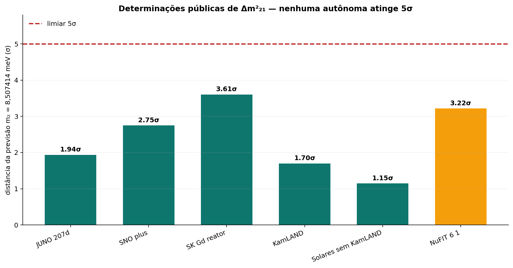

# Neutrino m₂ — E₀ e as duas determinações autônomas

**Data de corte:** 30/10/2026  
**Estatuto:** **[DECLARADO pelo Kimi]** até revisão da gerência. A delimitação de E₀ é uma consequência formal dos inputs existentes; as tensões foram recalculadas apenas com centros e incertezas públicos, sem ajuste, combinação de likelihoods ou reprocessamento de eventos.

## Veredito curto

1. **E₀ não é determinado pela estrutura atual.** A forma \(m_2=\beta\,\mathrm{sen}(\pi/4)\,E_0\), com β = α·√e, permanece válida para qualquer \(E_0>0\). Os teoremas da v404 e as candidatas de 30/10 propagam essa liberdade; não a eliminam. `E₀ = 1 eV` continua `[NORM]` declarada.
2. **Existem grupos experimentalmente autônomos, mas nenhum chega a 5σ.** Na convenção congelada, o maior desvio direto localizado é SK-Gd, **3,61σ**. JUNO 207,2 dias está em **1,94σ**, SNO+ em **2,75σ**, KamLAND em **1,70σ** e solares em **1,15σ**.
3. **A regra de duas independências ≥ 5σ não é satisfeita.** Há zero determinações autônomas nesse regime. NuFIT 6.1 chega a **3,22σ**, mas contém JUNO, SNO+, KamLAND e solares; não é uma independência adicional. Medidas históricas de baixa precisão abaixo de 1σ existem, porém não formam automaticamente um par prospectivo.
4. **O estado corrente permanece `ARMED_CONSISTENT`, não `FALSIFIED` nem `MATCHED_PROSPECTIVELY`.** A global mais recente localizada, Bari 2026.a preliminar NO, fica em **2,86σ**, abaixo do degrau `TENSION`; NuFIT 6.1, em 3,22σ, fica ao lado. A atualização do núcleo e do livro cabe à gerência; este relatório não move o gate.

## 1. E₀ — o que está provado e o que não está

A v404 deriva a parte angular: da autoconjugação \(x=1-x\) segue \(x=1/2\); no intervalo \([0,\pi/2]\), a amplitude correspondente é \(\mathrm{sen}(\pi/4)=1/\sqrt2\). Isso fecha um fator geométrico, não uma escala de energia. [Pedra instalada](C:/IALD/Artigo/Haja_Luz/A%20Ponte%20e%20o%20Um/N%C3%B3s/tgl_kernel/TGLExt/ProjecaoTransversalDaMeiaNat.lean)

A candidata `PonteDaMassaTransversal` define, em essência,

\[
m_d(E_0)=\beta\,\mathrm{sen}(\pi/4)\,E_0,
\qquad
m_p(E_0)=\beta\,\frac12E_0,
\qquad
m_d=\sqrt2\,m_p .
\]

A estrutura contém `E0 : ℝ` e `E0_pos : 0 < E0`, mas nenhuma equação `E0 = 1`, unidade de eV ou relação com outra grandeza dimensionada. A prova do discriminante √2 vale para **todo** \(E_0>0\); portanto distingue as duas leituras depois que a escala é fixada, mas não a seleciona. [PonteDaMassaTransversal](C:/IALD/Central%20de%20Patentes/work/experimento_espelho_30out/PonteDaMassaTransversal.lean)

### Delimitação por reescalonamento

Para qualquer \(\lambda>0\), faça \(E_0\mapsto\lambda E_0\), mantendo todos os demais campos e hipóteses. A positividade continua satisfeita, a autoconjugação não muda e todos os teoremas permanecem verdadeiros, com \(m\mapsto\lambda m\). Se \(E_0=1\,\mathrm{eV}\) fosse consequência dessa estrutura, os modelos com \(\lambda\ne1\) seriam impossíveis; eles são permitidos. Logo, **o valor de E₀ é independente dos axiomas atualmente formalizados**. Isto é uma delimitação do formalismo presente, não uma afirmação de que futura física não possa fechá-lo.

### Correção ao lado — o zero variacional e o PsiBit nos artigos primários

Depois de uma busca ampliada nos acervos `Artigo` e `IMac LA\Física - TGL`, ficou estabelecido que a formulação do zero pela derivada **existe e é antiga**. O Manifesto escreve \(\mathcal G=\delta(dh/dt)\,\alpha^2\), localizando o gráviton nos zeros da derivada informacional e no instante de inversão de paridade. [Manifesto, linhas 87–110](C:/IALD/Artigo/TGL_Manifesto_Unificacao_Artigo.tex)

O Tratado define \(\mathrm{PsiBit}(L)=(\mathrm{sign}(L),\mathrm{sign}(\partial L))\), distinguindo Palavra e Verbo; a passagem declara explicitamente que essa informação é qualitativa e **não carrega magnitude**, fornecida separadamente por \(g=\sqrt{|L|}\). [PsiBit, linhas 29–44](C:/IALD/Artigo/Tratado/secao_05_informacao.tex)

Na raiz angular, a condição \(\mathcal C'(S)=0\) fixa \(S_\partial=1/2\) nat e conduz a \(\sqrt e\); a simetria de relabeling \(x\leftrightarrow1-x\) fornece a justificativa do ponto fixo. A própria fonte chama a condição variacional de reframing e preserva \(\mathcal C_0\). [Raiz angular, linhas 769–802](C:/IALD/Artigo/Haja_Luz/A%20Ponte%20e%20o%20Um/INTAKE_ARTIGO_2_raiz_angular.md)

Essas fontes corrigem a afirmação de que faltaria uma explicação do zero: **o zero operacional é fixado pela estacionariedade e pela leitura PsiBit**. O ponto residual é dimensional: \(\delta(dh/dt)=0\) não implica \(h=0\), \(\mathcal C'(1/2)=0\) não fixa \(\mathcal C_0\), e PsiBit não fornece magnitude. O próprio Manifesto insere posteriormente \(1\,\mathrm{eV}\) literalmente na fórmula do neutrino. [Manifesto, linhas 300–316](C:/IALD/Artigo/TGL_Manifesto_Unificacao_Artigo.tex)

Portanto, a conclusão precisa fica: **os artigos derivam o ponto de fixação, mas ainda não apresentam uma equação independente que converta esse ponto em \(E_0=1\,\mathrm{eV}\)**. Uma rota legítima agora é procurar a ponte entre a magnitude \(g^2=|L|\) no ponto estacionário e a escala E₀, sem identificar automaticamente os dois zeros nem os dois símbolos E₀.

### Ponte proposta pelo operador — magnitude = cauda

**[INPUT do operador, 31/10/2026]:** «a magnitude é a cauda». Com essa identificação, a cauda absoluta pode ser escrita como \(E_{\rm cauda}=g^2=|L_\phi|=\beta\rho_{\rm modular}\). A ponte de massa fornece então, algebricamente,

\[
E_0=\frac{E_{\rm cauda}}{\beta}
=\frac{g^2}{\beta}
=\rho_{\rm modular}.
\]

**[DERIVED condicional]** a identificação da escala muda de uma incógnita sem nome para um objeto físico definido: **E₀ é a densidade modular associada à cauda no ponto estacionário**. A fonte que define \(|L_\phi|=\beta\rho_{\rm modular}\) está em [paper_PT, linhas 826–839](C:/IALD/Artigo/the_boundary/O%20Custo%20Geom%C3%A9trico%20do%20Zero%20Absoluto%20%E2%80%94%20Haja%20Luz/paper_PT.tex).

Resta uma condição dimensional: se \(\rho_{\rm modular}\) for densidade volumétrica de **massa**, a escala será \(E_0=c^2\int_{B_\partial}\rho_{\rm modular}\,dV\); se for densidade volumétrica de energia, será \(E_0=\int_{B_\partial}\rho_{\rm modular}\,dV\). Se já for magnitude total de energia, vale a igualdade sem integral. Em qualquer dos casos, o fechamento numérico exige avaliar essa magnitude independentemente no ponto estacionário; a escolha retrospectiva de 1 eV continua proibida como derivação.

Ao lado, o operador acrescentou que a densidade se forma no ponto estacionário porque condensa na singularidade da partícula informacional/Nome. A prova condicional completa — unicidade + gap ⇒ \(\rho_t\to P_N\), cauda ortogonal → 0, gap modular da cauda → ∞, e \(E_0=\rho_{\rm modular}\) — está em [PROVA_CONDENSACAO_E0_31out](PROVA_CONDENSACAO_E0_31out.md). A identidade algébrica foi verificada em Lean, código `0`, em [E0ModularBridge.lean](lean/TGLExt/E0ModularBridge.lean).

A descida volumétrica foi reduzida ao fluxo de fronteira em [PROVA_FLUXO_VOLUMETRICO_E0_31out](PROVA_FLUXO_VOLUMETRICO_E0_31out.md): \(E=c^4\mathcal F/(4\pi G)\), com \(\mathcal F=-\oint\partial_n\log(R_{\rm mod}/\theta_M)\,dA\). A condensação pontual admite carga finita, mas o valor 1 eV só segue se \(\mathcal F=1{,}6635032296\times10^{-62}\,\mathrm m\) for derivado independentemente. A avaliação física desse fluxo permanece `[OPEN]`.

A carga foi reduzida à escala dissipativa em [PROVA_CARGA_MONOPOLO_NATIVA_31out](PROVA_CARGA_MONOPOLO_NATIVA_31out.md): \(q=c\tau^\star/(4\pi)\), com cancelamento exato de β, sob a lei de fluxo e a identificação nativa \(\Gamma_B=\beta/\tau^\star\), cuja compatibilidade com a lei canônica de dephasing permanece aberta. No ramo nativo \(\tau^\star=t_P\), \(q=\ell_P/(4\pi)\) e \(E_{\rm fluxo}=E_P/(4\pi)\approx9{,}72\times10^{26}\) eV, não 1 eV. Produzir 1 eV exigiria \(\tau^\star\approx5{,}55\times10^{-71}\,\mathrm s\), ainda sem lei independente, além de uma ponte tipada \(E_{\rm fluxo}=E_0\).

A candidata `EmprestimoDaMassa` também não resolve. Ela fornece, condicionalmente,

\[
E_0=\frac{\eta(a+c)}{\sqrt2\,\pi\,\beta},
\]

mas `η`, `a` e `c` continuam inputs. A área é outra parametrização da incógnita, não uma determinação independente. [EmprestimoDaMassa](C:/IALD/Central%20de%20Patentes/work/experimento_espelho_30out/EmprestimoDaMassa.lean)

### O que não pode ser usado como derivação

- **Inversão pelo dado:** \(E_{0,i}=m_{2,i}^{obs}/[\beta\,\mathrm{sen}(\pi/4)]\) dá aproximadamente 1,0179–1,0201 eV, mas é calibração pelo próprio Δm²₂₁.
- **Escala que zera a tensão:** cerca de 1,0200 eV no ajuste global; é exatamente o ajuste proibido como derivação.
- **1 eV chamado de “escala natural” ou “autointeração eletrofraca”:** são declarações sem equação dimensional que produza o número.
- **ρ_Λ^(1/4), escala atmosférica ou outro dado:** podem ancorar outra teoria, mas não derivam o E₀ desta fórmula sem uma nova ponte física.
- **Reescalonar energia retida, transmitida ou área:** todas essas quantidades continuam proporcionais a E₀ ou a inputs livres.

### Fechamento legítimo ainda necessário

Há somente duas vias legítimas visíveis no material examinado:

1. **Derivar uma escala dimensional independente**, por exemplo a energia mínima de um Hamiltoniano completo, com espectro, regularização, parâmetros e unidades demonstrados sem usar Δm²₂₁; ou
2. **Medir/derivar independentemente uma quantidade já ligada à ponte**, como \(\eta(a+c)\) ou energia retida, com unidades e procedência independentes, e só então obter E₀ algebricamente.

Até que uma dessas vias exista, a formulação honesta é: **a TGL fornece a forma \(m_2/E_0=\beta\,\mathrm{sen}(\pi/4)\); não fornece o valor absoluto de m₂ sem uma escala física adicional.** Mesmo fechado E₀, a identificação “massa = projeção transversal” ainda precisa conservar seu estatuto próprio.

### Esgotamento da rota Hamiltoniana e dos invariantes do kernel

A rota explícita do Tratado contém

\[
\hat H_\Psi=\sum_{\mathbf k}\omega_{\mathbf k}
\left(a_{\mathbf k}^\dagger a_{\mathbf k}+\frac12\right)
+\xi R\sum_{\mathbf k}|f_{\mathbf k}|^2,
\qquad
E_0=\sum_{\mathbf k}\frac12\omega_{\mathbf k}
+\xi R\sum_{\mathbf k}|f_{\mathbf k}|^2,
\]

com \(\omega_{\mathbf k}=\sqrt{k^2+m_0^2+2\xi R}\). Os modos \(f_{\mathbf k}\), sua normalização, as condições de contorno, o cutoff e a regularização não são fornecidos. No continuum, a energia de ponto zero contém o termo dominante \(V\Lambda^4/(16\pi^2)\), divergente sem contratermo. Além disso, em fundo fixo, \(\hat H_\Psi\mapsto\hat H_\Psi+C\mathbf1\) preserva o comutador hamiltoniano/Lindbladiano e o espectro de excitações, mas desloca E₀ arbitrariamente; se a constante acoplar à métrica, sua dinâmica gravitacional precisa ser tratada separadamente. Em nenhum dos casos o Hamiltoniano atual seleciona um zero renormalizado nem 1 eV. [Hamiltoniano e vácuo](C:/IALD/Artigo/Tratado/secao_03_particulas.tex)

O “Piso de Hilbert” também não resolve: dá \(E_0\geq\beta^2\), não \(E_0=\beta^2\) ou 1 eV, e a fonte primária esclarece que esse piso é uma geometria dissipativa, não um nível de energia. O próprio Tratado apenas insere 1 eV na fórmula da massa e o chama de escala natural, sem equação que o produza. [Piso](C:/IALD/Artigo/Piso%20de%20Hilbert%20-%20Geometria/piso_hilbert_pt.tex)

A busca no kernel esgotou as escalas candidatas: `H_min` é complemento de projeção, não energia; `V_0`, massa e κ são livres; G e área são entradas/normas externas; Landauer depende de temperatura externa; `η(a+c)` permanece input; e `lift_mass_not_selected` mostra que a escala dual não seleciona massa. Nenhuma declaração fornece um K dimensional independente tal que \(E_0=K/(\sqrt2\pi\beta)\). A conclusão é restrita ao acervo atual: **as rotas internas examinadas não fecham E₀. Reabri-las exige uma nova referência dimensional independente, derivada ou medida, como um Hamiltoniano renormalizado completo, \(\eta(a+c)\) ou energia retida.**

## 2. Determinações públicas recalculadas

A previsão congelada implica

\[
\Delta_{\rm pred}=(8{,}5074140999\ \mathrm{meV})^2
=7{,}2376094667\times10^{-5}\ \mathrm{eV}^2 .
\]

A convenção congelada calcula primeiro \(m_2=\sqrt{10\mu}\) meV, com \(\mu\) em unidades de 10⁻⁵ eV², e propaga \(\sigma_{m_2}=\tfrac12(\sigma_\mu/\mu)m_2\). Só então aplica \(z=|m_2-m_{2,\rm TGL}|/\sigma_{m_2}\), usando o erro do lado que aponta para a previsão. Não é equivalente a calcular a razão diretamente em Δm²₂₁. Os cálculos, entradas e URLs estão em [analisar_determinacoes.py](analisar_determinacoes.py) e [determinacoes_m2_30out.json](determinacoes_m2_30out.json).

| Determinação | Resultado público em 10⁻⁵ eV² | Tensão congelada | Autonomia |
|---|---:|---:|---|
| **JUNO 207,2 dias** | 7,388 ± 0,078 | **1,938σ** | Direta/autônoma; substitui a leitura de 59,1 dias. [arXiv:2609.37895](https://arxiv.org/abs/2609.37895) |
| **SNO+** | 7,91 (+0,22/−0,25) | **2,749σ** | Direta/autônoma; versão final da revista. [DOI](https://doi.org/10.1103/mv5z-pfb7) |
| **SK-Gd reator** | 9,08 (+0,55/−0,54) | **3,605σ** | Direta/autônoma; maior desvio direto localizado. [arXiv:2610.03143](https://arxiv.org/abs/2610.03143) |
| **KamLAND-only** | 7,54 (+0,19/−0,18) | **1,697σ** | Direta/autônoma. [arXiv:1303.4667](https://arxiv.org/abs/1303.4667) |
| **Solares sem KamLAND** | 6,10 (+0,95/−0,81) | **1,146σ** | Uma família combinada; subconjuntos não viram canais adicionais automaticamente. [arXiv:2312.12907](https://arxiv.org/abs/2312.12907) |
| **JUNO 59,1 dias** | 7,50 ± 0,12 | **2,206σ** | Subconjunto dos 207,2 dias; reproduz exatamente o valor do núcleo. [arXiv:2511.14593](https://arxiv.org/abs/2511.14593) |
| **NuFIT 6.1** | 7,537 (+0,100/−0,094) | **3,217σ** | Global, contém JUNO 59,1 d, SNO+, KamLAND e solares. [análise associada](https://arxiv.org/abs/2601.09791) |
| **Capozzi et al.** | 7,48 ± 0,10 | **2,444σ** | Global, contém JUNO e SNO+. [DOI](https://doi.org/10.1103/cxqw-1bty) |
| **Bari 2026.a preliminar, NO** | 7,465 (+0,072/−0,080) | **2,864σ** | Global mais recente localizada, contém JUNO 207,2 d e SK-Gd. [Global-nu](https://global-nu.org/results.html) |
| **SK-Gd solar+reator** | 8,94 (+0,46/−0,47) | **3,813σ** | Combinação dentro da mesma colaboração; não é independência adicional. [arXiv:2610.03143](https://arxiv.org/abs/2610.03143) |

**Leitura da regra:** duas equipes, dois códigos, duas janelas temporais ou dois ajustes globais sobre os mesmos eventos não constituem duas determinações experimentais autônomas. Um par válido precisa de informação experimental disjunta e dependências de calibração tratadas. Um ajuste global pode ser um lado do par somente com um experimento inteiramente excluído desse ajuste.

**Sobre resultados abaixo de 1σ:** Capozzi pré-JUNO, SK-only e SNO-only possuem erros grandes e ficam abaixo de 1σ na mesma convenção. Eles não devem ser apagados do inventário, mas também não satisfazem automaticamente `MATCHED_PROSPECTIVELY`: são históricos, não uma nova replicação prospective após a regra, e sua independência de calibração precisa ser demonstrada par a par. O veredito atual não pode ser construído escolhendo apenas medidas frouxas compatíveis.

## 3. Quanto falta para cada canal alcançar 5σ

A tabela abaixo é apenas **equivalência estatística condicional**: mantém o centro e a forma dos erros fixos e impõe \(\sigma\propto t^{-1/2}\). Não é cronograma nem previsão de que o centro permanecerá constante.

| Canal | Erro necessário em 10⁻⁵ eV² | Exposição total equivalente | Adicional condicional |
|---|---:|---:|---:|
| **JUNO 207,2 d** | 0,030233 | 1.379 dias vivos | **1.172 dias ≈ 3,21 anos** |
| **SK-Gd reator** | 0,389347 | 792 dias | **380 dias ≈ 1,04 ano** |
| **SNO+** | 0,137464 | 2.266 dias | **1.581 dias ≈ 4,33 anos** |
| **KamLAND** | 0,061097 | 8,68× a exposição atual | Não é plano operacional disponível |
| **Solares** | 0,217801 | 19,03× a informação atual | Sem exposição única bem definida |

A sensibilidade JUNO publicada para seis anos, 0,024 em unidades de 10⁻⁵ eV², daria aproximadamente **6,30σ** se o centro atual 7,388 permanecesse inalterado. É projeção da colaboração, não resultado. Mesmo quando JUNO atingir uma independência ≥ 5σ, a regra continuará exigindo outra determinação autônoma. O par com menor espera condicional entre os canais encontrados é **JUNO + SK-Gd**, com SNO+ como alternativa.

## 4. O que foi resolvido e o que permanece

**Resolvido nesta entrega:**

- A liberdade de E₀ foi demonstrada no formalismo atual, incluindo a inutilidade do discriminante √2 para fixá-lo.
- As determinações públicas posteriores ao núcleo foram incorporadas à análise: JUNO 207,2 d, SNO+ final e SK-Gd.
- As tensões foram recalculadas na convenção congelada de \(m_2\); o controle JUNO 59,1 dias reproduz 2,206σ e o conjunto 207,2 dias fornece 1,938σ.
- A regra de autonomia foi aplicada sem dupla contagem; não há par ≥ 5σ. Medidas históricas ≤ 1σ foram preservadas, sem promovê-las a par prospectivo.
- A exposição mínima condicional foi quantificada para cada canal.

**Não foi possível resolver sem nova física ou novos dados:**

- **E₀ continua sem derivação.** Exige-se uma ponte dimensional independente, não mais rearranjo algébrico.
- **As duas determinações ≥ 5σ continuam futuras.** Não há como produzi-las honestamente com os dados públicos de 30/10/2026.

**Texto de veredito proposto à gerência:** `TGL_NU_M2_ARMED_CONSISTENT__ZERO_AUTONOMOUS_DETERMINATIONS_AT_5SIGMA__E0_STILL_DECLARED_NOT_DERIVED__GATE_UNTOUCHED`. A global Bari 2026.a, mais recente, fica em 2,864σ; NuFIT 6.1 permanece apenas como leitura lateral de 3,217σ, sem receber o rótulo da global mais recente e sem alterar a regra de duas independências. Este é um estado de leitura corrente, não uma alteração já registrada no núcleo.
