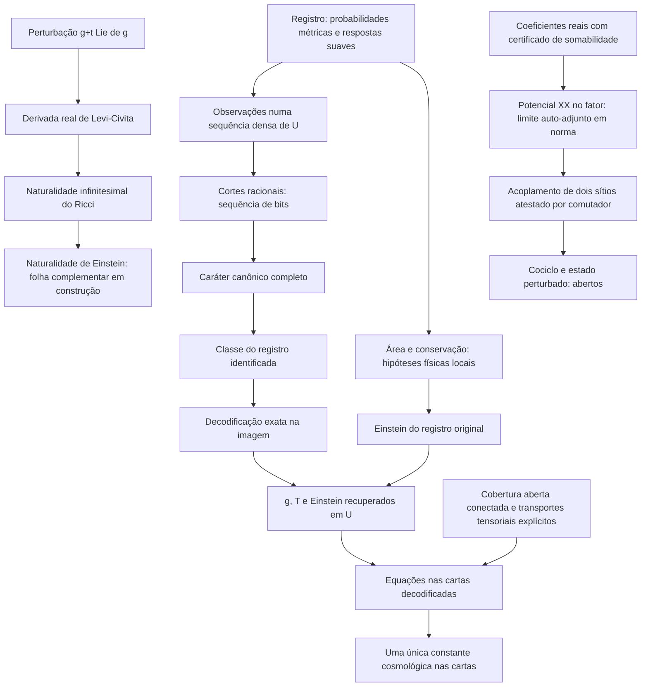

# Mapa da continuação — seleção, cartas e interação

09/09/2026. Registro novo; originais e memórias canônicas permanecem somente leitura.

[REAL — evidência de progresso] A etapa anterior completou o reexame v337 e congelou a preparação unificada de 48 resultados e a primeira variação métrica do Ricci. Esta continuação acrescenta provas efetivas sobre esses objetos. Não é uma repetição de status ou uma espera sem processo identificado.

## O que os novos elos significam

[REAL] O caráter completo identifica a classe do registro porque a completude das leituras foi derivada da continuidade, densidade e separação por racionais. A inversa atua na imagem do caráter e reconstrói os campos em todo U. O teorema transfere Einstein usando as leis físicas somente do registro original; a escolha de representante não acrescenta uma nova lei de área.

[INPUT/OPEN] O caráter é uma codificação de informação exata, obtida com escolhas não computáveis. A origem física das observações/caráter e sua estabilidade a erro experimental precisam ser ligadas à seleção pretendida. O caráter não é automaticamente o ângulo de peso de um único ramo. A composição de cartas tem um valor de caráter por carta e um parâmetro de leitura t comum.

[REAL] A conectividade por encontros das cartas é derivada de cobertura aberta de espaço preconexo. As constantes locais coincidem graças à não nulidade da métrica e às transformações tensoriais explícitas.

[INPUT/OPEN] As matrizes dos encontros ainda devem ser ligadas aos Jacobianos de um atlas diferenciável físico. A transformação de Einstein em transições finitas está entre as hipóteses da colagem. A naturalidade infinitesimal do Ricci não foi apresentada como prova automática de toda transição finita.

[REAL] Foi construído um potencial de interação no Hilbert/fator canônicos, com limite em norma e erro limitado pela cauda dos coeficientes. O exemplo certificado de um vínculo tem duplo comutador bipartido não nulo e, no perfil não tracial declarado, está fora do centralizador.

[INPUT/OPEN] Os termos XX comutam entre si. O teste de centralizador trata sua relação com o estado modular. O potencial limitado não fornece sozinho o cociclo da dinâmica perturbada, seu estado KMS, seu tensor de matéria gravitacional, ausência de anomalias ou um limite ultravioleta relativista.

## Preservação e estatuto

As fontes e recibos desta etapa vivem em pastas novas de Chatgpt. Não houve execução/importação de um.py, alteração de gate ou novo teste empírico de natureza. A integração no cânone permanece a cargo da sessão que o mantém. A auditoria final consolidada registra os hashes e os limites de compilação; dependências transitivas não foram todas recompiladas nesta etapa.
