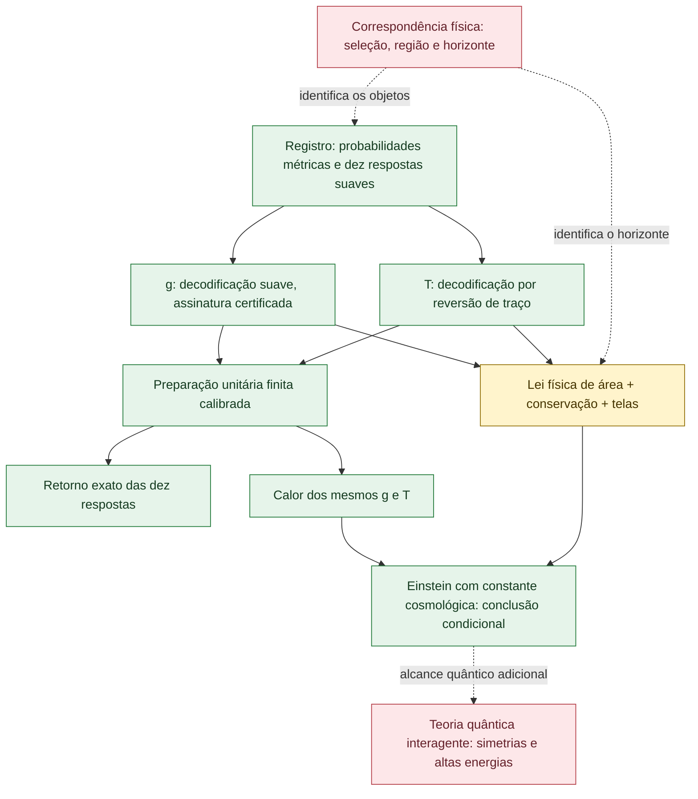

# Mapa desta rodada — cópia de trabalho, sem alterar o desenho canônico
[REAL/INPUT/OPEN] O mapa abaixo conserva as condições dos enunciados. Verde indica prova no domínio matemático declarado; amarelo, hipótese/interface; vermelho, obrigação de alcance geral ainda não descarregada.

O bloco verde g inclui o certificado Lorentziano que o tipo recebe; não significa derivação da dimensão/assinatura a partir de um ângulo isolado. O bloco verde E prova uma implicação, com H como premissa.

| Frente | O que já tem prova neste arco | O que não se infere automaticamente |
|---|---|---|
| Registro angular | Inversa na imagem com fase e rótulo; distinção dos ramos quando necessária | Inversa de todo colapso ou informação apagada arbitrária |
| Resposta de fonte |10coeficientes, g conhecido e ida/volta exata da preparação calibrada | T a partir da base inicial fixa; resposta geral determinada por dados somente nulos |
| Geometria e fonte conjuntas | Estrutura de dados fornece g,T,curva e Einstein condicional | Seleção física dessa entrada e lei de área sem hipótese de correspondência |
| Covariância | Transporte pontual da família escolhida | Colagem global e igualdade de recodificações independentes |
| Mistura | Incrementos e coeficientes preservados, rótulos legíveis | Entropia absoluta ou custo Meia-Nat preservados |
| Perturbações | Gauge geral em Minkowski; δR de conexões; δLC da métrica real | Anomalias quânticas interagentes; toda a variação métrica em fundo curvo |
| Natureza | Vereditos v336 lidos e ligados por hash à fonte | Exaustão de todos os dados ou confirmação universal |

[OPEN — composição suplementar em curso] O operador da mistura inteira e sua especialização ao registro de48resultados têm entregas próprias; a derivada do Ricci também segue em suplemento. Não foram incluídos por antecipação na contagem dos28módulos congelados.
