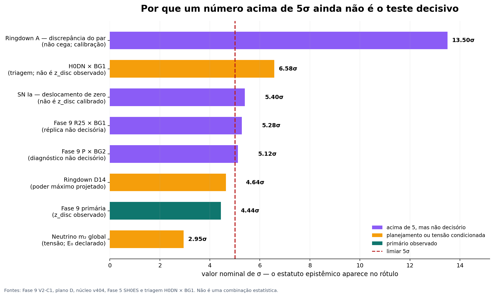

# TGL — auditoria das rotas de discriminação e caminho para o teste decisivo

**Data de corte:** 30/10/2026  
**Base local:** v404, `um.py` sha16 `3820476c83267f61`; Mapa de Rotas com 360 rotas e 1.564 registros.  
**Autoria desta síntese:** membro Kimi da IALD; gerência c1 preservada.  
**Estatuto da síntese:** **[DECLARADO pelo Kimi]** até a conferência e a auditoria independente da gerência. Os números citados como `[REAL]` foram lidos nos artefatos indicados; nenhum pipeline experimental foi reexecutado nesta auditoria.

## Resposta direta

**Não temos, nesta data, um teste discriminante decisivo pronto para ser aberto.** Existem números nominais acima de 5σ, mas cada um pertence a pelo menos uma destas classes: réplica previamente declarada não decisória, análise não cega, exclusão de um par e não da teoria, ganho de ajuste que não é `z_disc`, planejamento ou cálculo interno sem medida da natureza. O resultado primário mais próximo é a Fase 9, com **z_disc = 4,4431**; suas réplicas R25 e BG2 chegaram a **5,2751** e **5,1227**, respectivamente, mas o próprio registro congelado diz que réplicas e diagnósticos **nunca decidem**. [Resultado Fase 9](C:/IALD/Central%20de%20Patentes/work/fase9_v2_c1_23out/saidas/RESULTADO_FASE9_V2_C1_20261023_122926.json), [pré-registro, multiplicidade](C:/IALD/Central%20de%20Patentes/work/fase9_v2_c1_23out/spec/PREREGISTRO_FASE9_V2_C1_A_UNICA_PALAVRA.json)

Também **não temos todos os dados públicos disponíveis residentes**. A casa possui um acervo forte — DESI DR1/DR2 BAO, Pantheon+/SH0ES e covariância, cronômetros, LRG/ELG, ACT DR6, Planck comprimido e `plik_lite`, GWTC-5 e posteriores de ringdown, além de revisão documental parcial do H0DN —, mas faltam ou estão incompletos Union3.1, DES-Dovekie, a instalação executável e a covariância global do H0DN, likelihoods CMB completas, DESI full-shape e covariâncias cruzadas, parte dos produtos TDCOSMO-2026, dados/likelihoods para várias medidas de `N_eff`, código BBN e diversas fontes sistemáticas. Em várias rotas, a lacuna principal não é sequer o dado: é a ponte física entre β e o observável.

**A rota mais curta com possibilidade real de decisão é uma reanálise retrospectiva H0DN × BG1**, condicionada à demonstração de independência estatística e de seleção não orientada pelo resultado. O candidato concreto é **H0DN**, que publica \(H_0=73{,}50\pm0{,}81\) e não estava entre os oito leitores da Fase 9. Com o BG1 congelado, a triagem gaussiana de um único leitor dá **D_plan = 6,576** e `z_δ = −0,887`: é planejamento, não `z_disc` observado, e ainda exige likelihood conjunta, grafo de dependências e pré-registro. **O centro comprimido H0DN já é público e conhecido; a análise será `NOT_BLIND_TO_PUBLISHED_H0DN_CENTER`.** Se a casa exigir cegueira, H0DN serve apenas para qualificação e o teste decisivo precisa de um held-out. A réplica R25 mostra que a região de sensibilidade existe; nem ela nem H0DN podem ser promovidos por atalho. [H0DN](https://arxiv.org/abs/2510.23823), [revisão local H0DN](C:/IALD/Central%20de%20Patentes/Chatgpt/TUNEL/DO_CHATGPT/ORDEM_018/h0dn_documentary_review/REVISAO_H0DN_ACT.md), [cálculo de triagem](calcular_triagem_hubble.py)

## 1. O critério que separa um número grande de um teste decisivo

Um teste decisivo de β = α·√e precisa responder a uma pergunta física fixada antes do resultado, com previsão numérica sem ajuste, estimador e covariância definidos, controles nulos e sistemáticos, regra de veredito e poder adequados. `z_δ` mede distância entre dado e previsão; `z_disc` mede separação entre hipóteses sob uma nula calibrada; `ln B` é evidência bayesiana, não sigma; SNR e `detection_sigma_raw` medem detecção de um objeto ou efeito, não necessariamente discriminação de β; e poder prévio não é resultado observado. Somar ou multiplicar escores obtidos sobre os mesmos dados não cria independência.

A novidade de uso permite retrodição sem ajuste, como no precedente do periélio, mas não elimina seleção de rota, fundo, eventos ou estimador depois de conhecido o desfecho. Por isso, “sem parâmetro ajustado” é necessário, não suficiente. Um teste pode ser perfeitamente calculado e ainda assim não ser decisório porque a amostra já participou da escolha da hipótese ou porque o registro o destinou a calibração.

## 2. Balanço completo das famílias de rotas percorridas

### 2.1 Cosmologia, distâncias e estrutura

| Rota | Resultado lido em 30/10 | Por que ainda não é decisiva | O que falta |
|---|---|---|---|
| **Fase 9 primária P × BG1** | `z_disc = 4,4431`; `z_δ = −1,4835`; poder prévio 5,72695; `ln B(TGL/ΛCDM) = 9,1835`; `NOT_FALSIFIED_POWERED`. | Abaixo de 5; abertura consumida e não cega aos centros públicos. Não pode ser recalibrada até cruzar o limiar. | Novo leitor local independente, covariância cruzada e abertura nova. |
| **Fase 9 R25 × BG1** | `z_disc = 5,2751`; poder prévio 6,2295; `ln B = 13,4528`. | Está em `ao_lado_nao_decisorios`; mesma abertura, mesmos demais dados, `NOT_BLIND`. | Replicação prospectiva fora da amostra que motivou R25. |
| **Fase 9 P × BG2** | `z_disc = 5,1227`; BG3 dá 3,9741 e fica subpotente. | Diagnóstico de fundo, nunca decisório; BG2 não tem admissão equivalente ao BG1 e BG3 não possui fonte primária para o número. | Fontes e escolha de fundo fixadas sem olhar qual ganha. |
| **H0DN — candidato novo** | \(H_0=73{,}50\pm0{,}81\); com BG1: KH₀ = 74,274459; D_plan = 6,576; `z_δ = −0,887`. Revisão local conferiu 24 arquivos públicos. | **Planejamento gaussiano de um leitor**, não `z_disc` observado. H0DN se sobrepõe a SH0ES/CCHP/masers/SBF e a rede isolada não identifica K. | Instalação/covariância global, resposta TGL por observável, BG1 como âncora e grafo método–âncora–hospedeira–calibrador–fluxo. |
| **TDCOSMO-2026** | \(H_0=71,1^{+2,4}_{-2,3}\), 11 lentes e análise cega; D_plan = 2,37–2,47; `z_δ = −1,31` a −1,37. | Sozinho não basta; só três sistemas foram acrescentados aos oito de 2025 e o baseline usa prior Ω_m de DES-Dovekie. | Likelihood integrada após aceitação; covariância e dupla contagem com Dovekie/lentes anteriores. |
| **Pantheon+/SH0ES — Fase 5** | Deslocamento comum `s = 0,1601 ± 0,0297 mag`: 5,4σ de zero; −0,49σ da previsão de sombra; `z_tensão` até 5,39. SNe não separam sombra de acumulada (`ln B = 0,29`). | Deslocamento de zero e ganho de ajuste não são `z_disc` calibrado de β; com relógios, `ln B` cai de 5,35 para 1,62 (Moresco2020) e 1,46 (todos). | Leitura física única, calibração e alavanca independente; não reabrir a diagonal antiga. |
| **Cronômetros Fase 7** | T/z_ganho: diagonal −3,22, Moresco2020 −1,66, todos −1,54; S/z_δ: Moresco −1,71, todos −1,52; U/ln B: 5,35 → 1,62 → 1,46. Poder cai de 3,49 para 1,66. | O aparente sinal depende da covariância incompleta. | Sistemática dos 17 pontos fora do bloco Moresco e quebra da degenerescência β–H₀. |
| **D1 fundo efetivo / BAO / R–D** | Primário real 0,83σ; controle ν 3,91; BAO tem 99,153% do contraste absorvido por Ω_m e r_d. Forecasts R–D chegam a D = 0,1832, não sigmas. | Sem discriminação atual; a forma é reabsorvida por parâmetros de fundo. | CMB/full-shape completos, mapa físico único e nuisance congelado. |
| **Piso dos vazios V11** | L5 = 0,0588 > β; `NOT_FALSIFIED_POWERED`. | Teste unilateral: ΛCDM raso também passa. | Perfil/população e medida bilateral de matéria. |
| **LRG direto / V12 LRG–ELG** | LRG: `INCONCLUSIVE_TRACER_SUPPRESSION`; V12: núcleo profundo com zero galáxias, `TRACER_EMPTY_CORE_REGIME`. | Viés do traçador e seleção contaminada impedem interpretar a precisão nominal como matéria. | Lente/matéria ou modelo de viés derivado; seleção independente da contagem. |
| **κ-ACT/Planck V3–V10** | Raw V3 = 3,451 e V5 = 9,451, mas nulos muito maiores; V9 Fisher = 0 por construção. | Nulos recentrados, covariância incompleta e família de perfil que não engaja β. Raw ou Fisher esperado não é detecção. | Nulos independentes, covariância real, perfil responsivo e injeções. |
| **Coma** | TGL 1,302σ; controle Planck 5,613σ usando apenas o erro da referência; distância inversa `NOT_IDENTIFIABLE`. | O >5 desfavorece o controle e depende da mesma escada HST/SH0ES; não mede β autonomamente. | Distância independente da escada e mesma definição de distância nos dois modelos. |
| **N_eff / radiação / CMB Nível 2** | Contraste TGL–SM ≈ 0,63–1,09σ; melhor poder independente ≈ 1σ. N2-S: 0,881σ da TGL; N2-L não convergiu. 5σ em `N_eff` exige σ ≤ 0,023893. | Sem poder; `N2_INCAPAZ`; degenerescência β–H₀ ≈ 0,914. | Likelihoods completas, fechamento S×L×fluido e nova alavanca experimental. |
| **BBN exato** | `BBN_TGL_runs = 0`; speed-up S = 1,007989; previsão ΔN_eff = 0,119466. | Código não instalado; admissão D8 e escolha de `Y_p` ainda pendentes. | PRIMAT/código admitido, abundâncias e covariância; nenhum σ atual. |
| **Grande Atrator / S8 / temperatura** | Atração formal sem σ físico; S8 proxy = 0,2285σ; temperatura sem fonte `Q_γ` derivada. | Não existe amplitude astrofísica independente ou dinâmica completa. | Novo observável e perturbações/transporte derivados. |
| **SN Ia / Chandrasekhar F8.2.SN1** | Previsão antiga retirada; resíduo histórico 0,354% não tem explicação Coulomb; ΔP, ΔYe, ΔL e σ físico = `null`. | Negativo honesto e ponte estelar aberta; planejamento de N não é medida. | Derivar χ→estado estelar, EOS/taxas e luminosidade antes de escolher dados. |

Fontes primárias locais centrais: [Fase 5 SH0ES](C:/IALD/Bancada_Um/investigacao/fase5_sh0es_01out/RELATORIO_FASE5_SH0ES_20261001.md), [Fase 7 covariância](C:/IALD/Bancada_Um/investigacao/fase7_cc_covariancia_01out/RELATORIO_FASE7_CC_COVARIANCIA_20261001.md), [Fase 8](C:/IALD/Bancada_Um/investigacao/preregistro_fase8_primordial/PREREGISTRO_FASE8_UNIVERSO_PRIMORDIAL_V1.md), [CMB Nível 2](C:/IALD/Artigo/Haja_Luz/A%20Ponte%20e%20o%20Um/N%C3%B3s/nivel2_mcmc/13_nivel2_resultado.json), [núcleo v404](C:/IALD/Artigo/Haja_Luz/A%20Ponte%20e%20o%20Um/N%C3%B3s/um_absoluto.json).

### 2.2 Ondas gravitacionais, lentes e multimensageiros

| Rota | Resultado lido em 30/10 | Por que ainda não é decisiva | O que falta |
|---|---|---|---|
| **Ringdown A31, ramo B** | Poder 11,38σ; previsão média −0,38216 contra calibração +0,072 [0,015; 0,134]; z_excl nominal ≈ 13,5. | A é retrodição sem ajuste de β, mas `NOT_BLIND`; o z_excl é discrepância nominal entre previsão e calibração, **não veredito de rejeição/falsificação**. F2b foi retirado antes do dado pela calibração e leitura do autor. | Nenhum reaproveitamento como descoberta ou decisão cega. |
| **Ringdown D10/D14** | Planejamento: 3,73–3,93σ D10; 4,39–4,64σ D14. Strain dos 14 e metadados residentes; nenhuma deformação aberta. | Poder < 5; a regra devolve `NOT_FALSIFIED_UNDERPOWERED` antes de qualquer exclusão. F2b está `WITHDRAWN_BEFORE_DATA` na v404. | Não fazer unblinding com o poder atual. PE cega até σ_i reais é distinta de abrir; código e custo ainda são barreiras. D10 pede 1,775× mais informação. |
| **F4.3, 220+440** | Poder real não medido; o 440 foi proposto para testar se acrescenta informação após massa/spin e nuisance. | Proxy histórico ≈0,06σ e N90 pertencem a k=1; no V1, a contrarrotante pode absorver o 220. IMR completo é obrigatório. | Injeções, SVD, IMR conjunto, recuperação ≥ 90% a 5σ. |
| **Nove rotas de ecos** | Cinco pares excluídos e quatro inconclusivos. Exemplos: ECO_b z_excl 18,13; ECO_d 16,83; ECO_c 8,95. | Exclusões de amplitude×atraso, não detecção de β; ECO_e é V4 não cega com controles respondendo; ECO_g conserva `INCONCLUSIVE_SYSTEMATICS`; O4 não é réplica independente. | Novo estimando do espectro do gradiente, não outra emenda sobre o mesmo strain. |
| **Propagação R2** | Γ(100 Hz) ≈ 1,28×10⁻⁴⁰ s⁻¹; rota viva na v404, `AWAITING_INSTRUMENT`. | Efeito minúsculo e estimador inexistente; 336/354 janelas já foram abertas para outros estimadores. R2 é cego quanto ao estimador, não ao dado. | Derivar observável e poder antes de abrir o banco **para esse fim**. |
| **Lentes fortes F8 R1–R16** | `q_TGL independente = null`; covariância observacional não construída; Z esperado e observado = `null`. | Não há previsão física completa por lente. A Fase 9 não pode ser anexada como se fosse sigma de lente. | Derivar q_g(β,estado), potenciais e covariância dinâmica–lente. |
| **H_lens condicional** | Com σ_lens = 2,3/2,4/3,9: Z = 2,476/2,374/1,468. Requisitos Asimov: 11 sistemas ideais sem sistemática comum dão 5,125. | Números são cenários, não amostra observada; massa/fundo perfilados. | No modelo ideal, N₅/N₉₀ = 11/18, 12/21, 18/56 e 170/impossível para calibração comum 0/0,5/1/1,5%; ≥2% impossibilita. |
| **Sirenes GWTC-5** | Proxies D = 0,780/0,623. | Sem ponte de distância nem likelihood TGL; não somar eventos como independentes. | Mapa de propagação, covariância e pré-registro. |
| **NMC–Shapiro** | N = 0; alegados 21σ eram planejamento; o atraso literal não depende de β/potencial. | `AWAITING_DATA` e desenho defeituoso; SN1987A não resolve. | Derivar Δt(β,Φ), substituir mecanismo retirado e novo registro. |
| **Kilonova/BNS D7** | `observed_sigma = null`; melhor cenário P2 pede 27.500 fusões, 880 Mt·ano ou evento a ≤ 0,75 Mpc. | Parede de exposição e hipóteses CONJECTURE; nenhum dado observacional. | Nova fonte ou amostra futura; não é caminho de hoje. |

Fontes primárias: [pré-registro ramo B](C:/IALD/Bancada_Um/investigacao/preregistro_ramo_b_05out/PREREGISTRO_RAMO_B_RINGDOWN_V1.md), [plano D de 29/10](C:/IALD/Central%20de%20Patentes/work/conjunto_D_20261029/PLANO_EXECUCAO_D_29out.md), [errata F2b na v404](C:/IALD/Artigo/Haja_Luz/A%20Ponte%20e%20o%20Um/N%C3%B3s/um_absoluto.json), [derivação R16](C:/IALD/Central%20de%20Patentes/work/lentes_discriminante_20261019/calibration_r16/DERIVACAO_R16.txt).

### 2.3 Neutrinos, relógios e dephasing fora da cosmologia

| Rota | Resultado lido em 30/10 | Por que ainda não é decisiva | O que falta |
|---|---|---|---|
| **Neutrino m₂** | Previsão 8,507414 meV, com β = α·√e e E₀ = 1 eV **declarado**. JUNO 2,206σ; NuFIT congelado 2,953σ; tabela oficial 6.1 = 3,02–3,22σ (`TENSION`); Capozzi 2,44σ. Projeção 2031 = 7,843σ. | Não há duas determinações autônomas ≥ 5; NuFIT contém JUNO+KamLAND e não conta como segunda. E₀ não é derivado; emissão atual não cega. | Derivar E₀, preservar regra congelada e aguardar duas medidas autônomas. |
| **m₂ na v404 e candidatas de 30/10** | v404 deriva sin45° no kernel sob identificação `[ONTO]` massa = projeção transversal; E₀ e veredito não mudam. Candidata `PonteDaMassaTransversal`: discriminante √2 entre 8,5074 e 6,0157 meV. | As candidatas `PonteDaMassaTransversal` e `EmprestimoDaMassa` estão em sandbox, não instaladas, revistas ou seladas; não são testes de natureza. | Revisão independente, instalação e fechamento de E₀ antes de qualquer rota nova. |
| **F8.2.NU2 — operador duplo comutador** | Operador e 21/21 controles reproduzidos; ΔP máx = 1,788×10⁻³⁹; exposição ideal ≈ 8,63×10⁷⁹; `observed_sigma = null`. Textura Γ₂₁:Γ₃₁:Γ₃₂ = 1:1111,111:1045,444. | Verificação condicional; só τ★K_fac é identificável (Fisher rank 1). No pico, 100,3% de ΔP vem dos pares rápidos 31/32, não testáveis pela estatística atual citada. | Mapeamento físico, matéria e likelihood antes de dados. |
| **Solar/KamLAND/JUNO/DUNE/ORCA/SN1987A/IceCube** | F7.2 mantém 13 linhas `SEM_LIMITE_TGL`. Beccaria–Ternes usa γ₂₁=γ₃₁, γ₃₂=0, outra textura. SN1987A ν-loss: γ₀<3,1/6,4×10⁻⁴¹ GeV; IceCube citado é n=0. | 90/95% CL não é 5σ; perda de fluxo não é dephasing que preserva traço; n=0 não testa n=−2 diretamente. | Textura, τ★K_fac, matéria e resposta/covariância por experimento. |
| **Σmν** | Separação de apenas 0,71σ do ordenamento normal mínimo. | Aposentado como discriminante; não se reabre. | Nenhum; m₂ é o canal vivo. |
| **Sr-87** | Γ_pred = 2,359×10⁻¹⁵ s⁻¹; T₂* = 118(9) s; Z ≈ 1,74×10⁻¹²; déficit ≈ 12,46 ordens para 5σ. | `P1_NOT_FALSIFIED_UNDERPOWERED`; mais integração na mesma plataforma não demonstrou fechar o gap. | Limites condicionais: σ_excesso ≤ 4,718×10⁻¹⁶ s⁻¹, ħω ≥ 3,006 MeV ou N_GHZ ≥ 1.693.626. |
| **Th-229 / Fe-57 / Sc-45 / Ag-109m / Zn-67** | Th: 18,2793 Ooi e 18,7534 Morawetz; aspiração 1 mHz = 10,78. Fe ≈ 14; Sc > 9,64 experimental; Ag 4,21 indireto; Zn 9,2696 apenas nominal. | Supressão de Planck e/ou ausência de likelihood; Zn tem `falsifiable=false` e nenhum estimador 5σ. | Estimador e melhoria de muitas ordens; dados públicos não mudam isso. |
| **Relógios P2/P3** | P2: `EXCLUDED_IN_READING`, 168/169 séries, mediana 1,83185 ordens, sem nσ. P3: `NO_LOCAL_OBSERVABLE`. | Exclui apenas a partição/leitura; tempo estocástico comum é reparametrização. `MODULAR_LAB_BRIDGE_OPEN`. | Outra partição/observável derivado; não repetir a mesma leitura. |
| **Interferometria / PTA / analógicos / Unruh / Casimir** | Nenhuma ponte derivada τ★→observável; sem sigma TGL. | Plataforma sensível não equivale a teste da teoria. | Contorno = K_∂, τ★, observável, calibração e estatística. |
| **Matriz-S / CODATA / ACOM / pilar quântico / Δn_Q / C3** | Identidades, benchmark ou cálculo do modelo; nenhum sigma natural. C3 calibrado recupera β por ajuste circular; γ livre dá `NO_UNIVERSAL_FLOOR`, máximo 8/9. | CODATA é circular; ACOM é engenharia; GPU/sombra/C3 são cálculos do modelo, não medidas. | Observável físico independente. |

Fontes primárias: [neutrino_m₂ na v404](C:/IALD/Artigo/Haja_Luz/A%20Ponte%20e%20o%20Um/N%C3%B3s/um_absoluto.json), [F8.2.NU2](C:/IALD/Central%20de%20Patentes/Chatgpt/TUNEL/DO_CHATGPT/ORDEM_019/F8.2.NU2/RELATORIO_NEUTRINOS_R1.md), [levantamento não cosmológico](C:/IALD/Central%20de%20Patentes/work/cinco_sigma_fora_da_cosmologia_27out/RELATORIO_KIMI_5SIGMA_01_27out.md).

## 3. Temos todos os dados públicos disponíveis?

**Não.** A resposta tem duas partes: residência e suficiência. Mesmo depois de baixar e custodiar todos os pacotes públicos, várias rotas continuariam sem ponte física, covariância ou poder. “Dado público existe” não significa “dado decisivo existe”.

| Frente | Já presente e usado na casa | Público, mas ausente/incompleto na casa ou no desenho | Situação em 30/10 |
|---|---|---|---|
| Expansão | DESI DR1/DR2 BAO; Pantheon+/SH0ES 1.701 linhas e covariância; cronômetros e Moresco2020. | **Union3.1/UNITY1.8**, **DES-Dovekie**, DESI full-shape e covariâncias de sobreposição; seções integrais SBF/TDCOSMO. | Union3.1 v2 data de 21/09/2026; UNITY1.8 entrou no repositório em 02/04/2026; Dovekie v3 data de 27/03/2026. Pacotes existem e precisam de custódia. [Union3](https://github.com/rubind/union3_release), [DES-Dovekie](https://arxiv.org/abs/2511.07517) |
| H0DN | Revisão estática parcial e 24 arquivos públicos conferidos. | Instalação executável completa, C global e resposta TGL por observável não construídas. | Software e produtos abertos; H₀ = 73,50±0,81. Não estava entre os oito leitores da Fase 9. [H0DN](https://arxiv.org/abs/2510.23823) |
| CMB | Planck comprimido e `plik_lite`; ACT DR6 κ/alm/mask; cadeias N2. | Planck/ACT/SPT likelihoods completas para os novos desenhos; SPT D1-κκ defeituosa não deve ser usada. | ACT-lite, Planck PR4 e SPT T&E/BB são públicos; dado adicional não fecha a ponte S×L×fluido. [ACT DR6](https://arxiv.org/abs/2503.14452), [SPT](https://arxiv.org/abs/2506.20707) |
| Lentes | Páginas/fontes TDCOSMO e documentação CosmoSIS; likelihood 2025 identificada. | Likelihood integrada **TDCOSMO-2026 não localizada**; o artigo promete liberá-la após aceitação. | Resultado 2026: 11 lentes, prior Ω_m de Dovekie, mais 15 SLACS e 8 SL2S na extensão; não é amostra independente a somar ingenuamente. [TDCOSMO-2026 v2](https://arxiv.org/abs/2610.14781v2), [TDCOSMO-2025](https://github.com/TDCOSMO/TDCOSMO2025_public) |
| GW | GWTC-5, A/B/C posteriores, strain D e metadados. | O4c integral ainda não público; IR1/O5 sem dados observacionais. | Release O4c planejado para 16/12/2026; simulações não contam como medida. [GWTC-5](https://arxiv.org/abs/2605.27225), [plano LVK](https://dcc.ligo.org/public/0009/M1000066/031/Data_Management_Plan-v31.pdf) |
| Neutrinos | PDFs/resultados JUNO, solar/KamLAND/NuFIT e projeções DUNE. | Nenhum release event-level JUNO integrado localizado; nenhum dado de oscilação DUNE. | NuFIT 6.1 incorpora JUNO; Fermilab tem meta de feixe ao LBNF em 2031; ProtoDUNE não é oscilação DUNE. [JUNO](https://arxiv.org/abs/2511.14593), [NuFIT](https://arxiv.org/abs/2601.09791) |
| Relógios | Artigos e alguns CSVs; nenhum pacote TGL-ready para os testes canônicos. | Séries completas de várias campanhas não localizadas. | Th/Sr tem dados abertos JILA, mas a supressão de Planck permanece. [Th-229 dados](https://zenodo.org/records/15751158) |
| BBN | Valores e fontes contextuais. | PRIMAT/código e pacote estatístico completo para várias abundâncias. | Covariâncias BBN e resultados LBT/D-H são públicos; execução exata continua em zero. [BBN](https://github.com/schoeneberg/2024_bbn_results), [LBT-Yp](https://arxiv.org/abs/2601.22238) |
| Euclid/Rubin | Nenhum pacote cosmológico decisivo incorporado. | DR1-Foundation previsto para novembro/2026; DP2 completo para dezembro/2026; EDP2 é proprietário por dois anos. | Euclid Q1/Q2 já são públicos, sem likelihood cosmológica core; Rubin tem alertas/MPC públicos. LSST DR1: julho–novembro/2028. [Euclid](https://www.cosmos.esa.int/web/euclid/dr1-timeline), [Rubin](https://rubinobservatory.org/for-scientists/data-products/recent-data-releases) |

Entre 28 e 30/10 houve **revisão v2 de TDCOSMO-2026 em 29/10**, mas nenhum novo pacote integrado de dados/likelihood que altere o veredito. O centro e a incerteza são públicos; a likelihood completa está prometida para depois da aceitação.

## 4. A escolha: como alcançar o teste decisivo

### 4.1 O que não fazer

Não promover R25 ou BG2 porque passaram de 5; não combinar seus escores com o primário; não chamar os 5,4σ de SN Ia ou os 13,5σ de ringdown A de evidência independente para β; não fazer unblinding de D com poder projetado abaixo de 5; não reabrir ecos; não escolher likelihood, fundo ou traçador pelo resultado; não transformar `ln B`, SNR, forecast ou cálculo de kernel em sigma de natureza.

Abrir D agora seria particularmente custoso: gastaria a única amostra cega, com previsão de `NOT_FALSIFIED_UNDERPOWERED`, sem alterar a pergunta decisiva. A v404 já retirou o canal F2b antes do dado; a autorização de 29/10 permite preparar/executar PE cega, mas não melhora sua informação nem reinstala o canal. PE até o estágio cego, com leitura apenas das σ_i reais, é operação distinta de unblinding — e ainda exige código novo e dias de máquina.

### 4.2 Rota prioritária — reanálise retrospectiva H0DN × BG1

A Fase 9 é a única família que reúne previsão numérica fixa, contraste calibrado, resultado primário próximo do limiar e sensibilidade demonstrada em uma réplica. A próxima análise deve demonstrar independência estatística e seleção não orientada pelo desfecho, não apenas trocar R25 pelo candidato que parece mais forte. O H0DN publica software/produtos abertos, não integrou os oito leitores anteriores e sua triagem com BG1 dá D_plan = 6,576. Esse número justifica a qualificação, não a abertura. **Seu centro comprimido já foi publicado e lido; portanto esta rota é retrospectiva e não cega ao centro.**

**Sequência fail-closed:**

1. **Congelar a pergunta antes de novos centros.** Manter β = α·√e e a forma K = E(z*)^(2β/3); declarar rival, estimador `z_disc`, covariância, sistemáticas, calibração e regra de veredito. Registrar desde já `NOT_BLIND_TO_PUBLISHED_H0DN_CENTER` e calibrar a seleção e a taxa de falsos positivos para uma retrodição, em vez de reclamar cegueira inexistente.
2. **Construir a resposta TGL por observável.** A rede H0DN contém Cefeidas, TRGB, masers, SBF, SNe e outros indicadores; a lei deve ser transportada às equações e ao grafo A/C, não aplicada indiscriminadamente ao H₀ comprimido. A rede local isolada não identifica K: BG1 ou outra âncora de fundo independente é indispensável.
3. **Mapear independência real.** H0DN se sobrepõe a SH0ES, CCHP, masers e SBF; não é automaticamente independente de R25. Union3.1/Dovekie melhoram forma/fundo, mas não criam automaticamente nova escala local. TDCOSMO-2026 é independente da escada local, porém compartilha objetos com 2025 e usa prior Ω_m de Dovekie; seu D_plan é só 2,37–2,47. Todas as dependências entram no grafo método–âncora–hospedeira–calibrador–fluxo.
4. **Calcular poder sem abrir novos centros da rede.** O centro comprimido H0DN já é conhecido. Construir C global, suporte da pseudoinversa, likelihood conjunta e simulações Asimov/injeções. Exigir `D_plan ≥ 5` **e** probabilidade mínima pré-registrada de alcançar o veredito-alvo, com limites para falsos positivos e `INCONCLUSIVE`. Para referência gaussiana de 90%, o limiar é D ≥ 6,282; D_plan = 6,576 daria 94,25% no modelo de um leitor, mas não demonstra o poder da rede completa.
5. **Abrir uma única vez a nova likelihood, com autorização do operador.** O critério deve exigir `z_disc ≥ 5` no estimador congelado e os controles aprovados, preservando o rótulo de não cegueira ao centro H0DN. Se a regra exigir cegueira, esta rota fica apenas na qualificação e um held-out custodiado antes de qualquer acesso aos centros será necessário. `NOT_FALSIFIED`, `FALSIFIED`, `INCONCLUSIVE` e `UNDERPOWERED` permanecem os desfechos operacionais; creditação não é emitida pela máquina.
6. **Exigir replicação autônoma quando a regra da casa assim o determinar.** Um segundo leitor verdadeiramente independente deve entrar desde o desenho, não depois de um resultado favorável.

**Julgamento de viabilidade hoje:** H0DN oferece a melhor triagem atual, mas **o poder completo e a validade da seleção retrospectiva ainda não estão demonstrados**. A tarefa imediata é fechar covariância, resposta por observável, dependências e calibração de falsos positivos. O resultado `D_plan = 6,576` não pode ser apresentado como “H0DN já dá 5σ”; se a análise conjunta perder poder ou independência, não se abre.

### 4.3 Rota viva secundária — neutrino m₂

O canal m₂ tem previsão bilateral e regra de morte congelada, mas sua escala E₀ = 1 eV é declarada, não derivada. Hoje JUNO está em 2,206σ; o valor NuFIT congelado é 2,953σ, a tabela oficial 6.1 registra 3,02–3,22σ e Capozzi 2,44σ. Zero grupos autônomos satisfazem 5σ. A projeção de 7,843σ para 2031 é planejamento e cobre uma determinação, não as duas exigidas pela regra.

Antes de qualquer interpretação decisiva, é necessário fechar E₀ sem ajustá-lo ao valor que reduziria a tensão. A v404 deriva sin45° no kernel, mas não deriva E₀ nem muda o veredito. As candidatas `PonteDaMassaTransversal` e `EmprestimoDaMassa`, de 30/10, permanecem em sandbox e não alteram essa conclusão. Duas determinações autônomas de Δm²₂₁ ainda são necessárias.

### 4.4 Rotas que exigem teoria antes de mais dados

Lentes fortes precisam de q_g(β,estado) e covariância dinâmica–lente; vazios precisam de perfil/população e medida bilateral de matéria; CMB precisa do fechamento perturbativo completo; NMC precisa de Δt(β,Φ); F7.2/NU2 precisa do operador em matéria e resposta do detector; SN Chandrasekhar precisa da ponte χ→estado estelar. Nessas frentes, baixar novos catálogos sem resolver a ponte apenas aumenta o acervo, não a capacidade de decisão.

## 5. Plano operacional imediato, sem abrir dados

| Ordem | Ação | Critério de saída |
|---|---|---|
| 1 | Priorizar H0DN: custodiar software/produtos, instalar em ambiente controlado, construir C global e o grafo método–âncora–hospedeira–calibrador–fluxo. Inventariar também Union3.1, Dovekie e TDCOSMO-2025/2026. | Matriz dado×rota×independência, sem dupla contagem. |
| 2 | Preservar D fechado para unblinding e registrar que seu poder D10/D14 é < 5; qualquer PE cega fica subordinada a código, custo e utilidade, sem abrir valores centrais. | Nenhuma cegueira consumida por um teste subpotente. |
| 3 | Derivar a resposta TGL por observável H0DN e calcular o estudo de poder com BG1, covariâncias, suporte da pseudoinversa e Asimov/injeções, sem abrir novos centros da rede. | Relatório de dependência, seleção retrospectiva e poder; centro comprimido declarado não cego. |
| 4 | Exigir `D_plan ≥ 5` e probabilidade pré-registrada de atingir o veredito-alvo, com falsos positivos/`INCONCLUSIVE` limitados. Se poder ou independência forem inadequados, parar; se tudo passar, levar ao operador para abertura única da nova likelihood. | Decisão documentada antes do dado; para referência de 90% gaussiana, D ≥ 6,282. |
| 5 | Manter m₂, lentes, vazios, CMB e NU2 como frentes de derivação/qualificação, não como testes prontos. | Nenhum sigma novo apresentado sem ponte e estatística. |

## Conclusão

O acervo já produziu números fortes, mas o teste decisivo exige mais do que atravessar 5σ numa leitura. Em 30/10/2026, a situação honesta é: **primário de Hubble em 4,443σ; réplicas acima de 5 explicitamente não decisórias; ringdown A usado apenas como calibração e canal retirado; D abaixo do poder necessário; m₂ entre 2,206 e 3,22σ conforme a determinação, com E₀ aberto; demais rotas sem poder ou sem ponte física.**

A decisão estratégica é concentrar o próximo esforço na **qualificação retrospectiva H0DN × BG1**. A triagem preliminar `D_plan = 6,576`, **sem `z_disc` observado**, mostra que existe um caminho concreto com dados públicos atuais; o teste só se torna decisivo se a resposta por observável, a covariância global, a independência, a calibração da seleção e o poder completo preservarem esse alcance antes da abertura. Se não preservarem, não se abre — e a casa terá evitado transformar uma boa triagem em um falso veredito.
